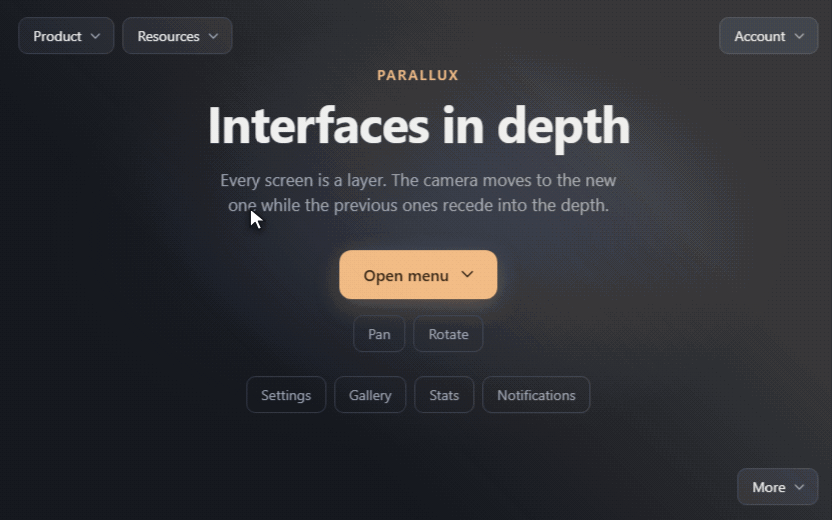
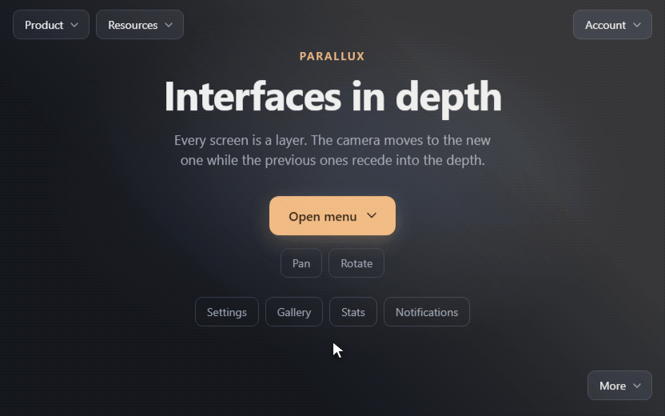
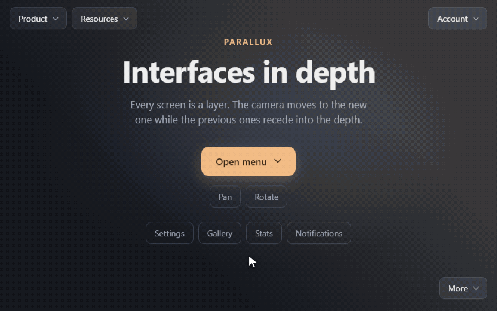
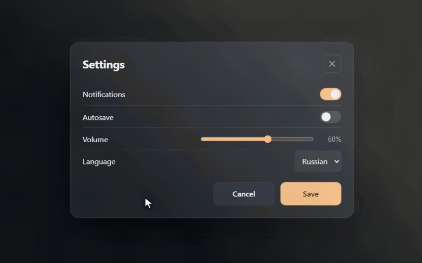

# Parallux

[](https://www.npmjs.com/package/@dimacrossbow/parallux)
[](https://bundlephobia.com/package/@dimacrossbow/parallux)
[](LICENSE)

The interface as a space. Screens, menus and modals are layers along the `z` axis, and moving between them is a camera move: the previous screen recedes into the depth, fading and shrinking, while the new one materializes in front of you.

Runs in the browser, framework-agnostic.

<p align="center">
  
</p>

## Showcase

<table>
  <tr>
    <td width="50%" valign="top">
      <br>
      <b>Screens stack in depth.</b> A gallery, then a photo viewer on top of it: three layers, and <code>close()</code> walks the camera back one step at a time.
    </td>
    <td width="50%" valign="top">
      <br>
      <b>A camera, not a slideshow.</b> <code>lookAt</code> flies to a dropdown and zooms in, while <code>flyTo</code> and <code>rotateTo</code> pan and turn the whole scene.
    </td>
  </tr>
  <tr>
    <td width="50%" valign="top">
      <br>
      <b>Any shape of layer.</b> Panels, drawers and dropdowns inside layers all live in the same space, and focus follows the camera.
    </td>
    <td width="50%" valign="top">
      <br>
      <b>Real depth.</b> Layers follow the pointer at a rate that depends on their distance, and a soft glare sits over everything like sunlight.
    </td>
  </tr>
</table>

All of this is the demo from this repository: run `npm run dev` to try it yourself.

## Installation

The package is published on npm as [`@dimacrossbow/parallux`](https://www.npmjs.com/package/@dimacrossbow/parallux).

```bash
npm install @dimacrossbow/parallux
# or
yarn add @dimacrossbow/parallux
pnpm add @dimacrossbow/parallux
bun add @dimacrossbow/parallux
```

[GSAP](https://gsap.com/) is a dependency and gets installed automatically. TypeScript types ship with the package, so you don't need to install anything extra.

The package works with both ES modules and CommonJS:

```ts
import { Parallux } from '@dimacrossbow/parallux';
```

```js
const { Parallux } = require('@dimacrossbow/parallux');
```

### Without a bundler

For a plain HTML page, import the package from a CDN. jsDelivr resolves GSAP for you:

```html
<script type="module">
  import { Parallux } from 'https://cdn.jsdelivr.net/npm/@dimacrossbow/parallux@1/+esm';

  new Parallux().add({ name: 'page', el: document.body.firstElementChild }).mount();
</script>
```

## Quick start

```ts
import { Parallux } from '@dimacrossbow/parallux';

const page = document.getElementById('page')!;
const menu = document.getElementById('menu')!;

const app = new Parallux()
  .add({ name: 'page', z: 0, el: page })
  .mount();

// Open a layer: the camera moves to it, and so does focus
await app.open({ name: 'menu', el: menu });

// Close: the camera and focus return, the layer is removed
await app.close();
```

For a full-page layer, give `html` and `body` a height of `100%` and remove their `margin`.

## How the space works

The camera looks toward decreasing `z`.

| Layer position | How it looks |
|---|---|
| Deeper than the camera (smaller `z`) | paler and smaller, the further away the more so |
| At the camera's level | as is |
| Behind the camera (larger `z`) | transparent, doesn't receive clicks |
| Beyond `drawDistance` | not rendered |

The camera never goes beyond the layers' `z` range. If you remove the layer under it, it moves to the nearest boundary. The camera starts at `z: 0`, so add the layer it should rest on first.

## API

Methods without a return annotation return `this`, so they can be chained. Methods returning a `Promise` resolve when their animation finishes. If an animation is interrupted by a new one, its promise resolves too.

### Layers

| Method | What it does |
|---|---|
| `add(layer)` | adds a layer |
| `pop()` | removes the most recently added layer |
| `removeByName(name)` | removes all layers with that name |
| `removeById(id)` | removes a layer by `id` |
| `removeByZ(z)` | removes all layers with that `z` |
| `open(layer, options?)` → `Promise` | adds a layer and moves the camera and focus to it |
| `close(speed?)` → `Promise` | closes the top layer opened via `open` |
| `closeAll(speed?)` → `Promise` | closes all layers opened via `open` |

`add` and `open` accept layer options or a ready-made `Layer` instance.

| Option | Default | Description |
|---|---|---|
| `name` | `''` | layer name |
| `z` | `0` | position on the axis. In `open` without `z`, the layer is placed above the others |
| `el` | new `div` | layer element |
| `width`, `height` | `'100%'` | size: a number in pixels or a CSS value |
| `scrollable` | `false` | scroll content inside the layer |

`open` shields the current layer from keyboard and clicks using `inert`, and restores focus on close. By default focus goes to the first focusable element in the layer; you can pass a different one in `options.focus`. If there is no such element, the layer itself receives focus.

A layer opened via `open` can also be removed with the `remove*` methods or `pop`: the camera and focus return just as with `close`.

An element created by the library is removed together with its layer. An `el` you passed in stays intact; it is only detached from the container.

### Camera

| Method | What it does |
|---|---|
| `moveTo(target)`, `moveBy(delta)` | moves the camera at the speed from the config |
| `flyTo(target, speed?)` → `Promise` | same, with its own speed and a promise |
| `flyBy(delta, speed?)` → `Promise` | relative movement |
| `lookAt(el, options?)` → `Promise` | brings the camera to an element |
| `zoomTo(zoom, speed?)` → `Promise` | changes the display scale |
| `rotateTo(angle, speed?)` → `Promise` | rotation around the Z axis, in degrees |
| `rotateBy(delta, speed?)` → `Promise` | relative rotation |

`target` is either a number (`z`) or an object with any of the fields `{ x, y, z, zoom }`. `speed` is `{ duration, easing }`.

```ts
await app.flyTo({ x: 160, y: -60 }, { duration: 700, easing: 'power2.inOut' });

// Movement and rotation are independent
await Promise.all([
  app.flyTo({ x: 100 }, { duration: 800 }),
  app.rotateTo(45, { duration: 300 }),
]);
```

`lookAt` is handy for elements that pop up, such as dropdown menus. It accepts `speed`, `approach` (what fraction of the way to the screen center to travel) and `zoom` (scale at the destination). The element stays fully on screen if it fits.

```ts
menu.hidden = false;
app.lookAt(menu, { zoom: 1.4, duration: 500 });

// Go back
menu.hidden = true;
app.flyTo({ x: 0, y: 0, zoom: 1 });
```

The camera's `zoom` defaults to `1`. It scales the whole scene and animates together with movement, whereas the `zoom` setting in the config only controls how layers shrink with depth.

The current position is available in `app.camera` (`x`, `y`, `z`, `zoom`, `angle`). This is the camera's target: it changes immediately, and the animation catches up with it.

### Observing

Camera fields and the layer list are reactive. You can observe them with functions from the package:

```ts
import { autorun, reaction } from '@dimacrossbow/parallux';

// Runs immediately and on every change to what it read
const stop = autorun(() => {
  status.textContent = `z = ${app.camera.z}, layers: ${app.layers.length}`;
});

// Called only when the value changes
reaction(() => app.camera.zoom > 1, (zoomed) => toolbar.classList.toggle('zoomed', zoomed));

stop();
```

| Function | What it does |
|---|---|
| `autorun(fn)` → `stop` | runs `fn` immediately and again whenever anything it read changes |
| `reaction(expr, effect, { equals }?)` → `stop` | calls `effect` with the new value of `expr` when it changes |
| `when(predicate)` → `Promise` | resolves when `predicate` becomes true |
| `batch(fn)` | defers reactions until the end of `fn`, so several changes trigger a single run |
| `untracked(fn)` | runs `fn` without subscribing to what it reads |

Reactions fire synchronously, right after a change or at the end of `batch`. An error in one reaction doesn't stop the others and is rethrown separately.

### Lifecycle

| Method | What it does |
|---|---|
| `mount()` | mounts the layers. After that you can keep working with the library |
| `destroy()` | removes layers and handlers, restores the container's styles. Layers opened via `open` are closed immediately. You can call `mount()` again afterwards |
| `onResize(callback)` | reports `{ width, height }` when the container size changes |

Percentage-sized layers adapt on their own. `onResize` is for content positioned in pixels:

```ts
app.onResize(() => placeMenu());
```

## Settings

Passed to the constructor; nested settings are merged with the defaults.

```ts
new Parallux({
  container: document.getElementById('stage')!,
  drawDistance: 4,
  transition: { duration: 600 },
  glare: { enabled: false },
});
```

It's convenient to keep settings in JSON and pass them as a whole:

```ts
import { Parallux, type TParalluxOptions } from '@dimacrossbow/parallux';
import config from './parallux.json';

new Parallux(config as TParalluxOptions);
```

The type cast is needed because TypeScript reads strings from JSON as `string`.

| Setting | Default | Description |
|---|---|---|
| `container` | `document.body` | where to mount the layers |
| `drawDistance` | `3` | how many `z` units deep layers are visible |
| `zoom` | `0.25` | how fast layers shrink with depth |
| `strength` | `20` | pointer-follow offset in pixels per unit of depth |
| `approach` | `0.35` | what fraction of the way to the screen center `lookAt` travels |
| `reducedMotion` | `'auto'` | `auto`, `always` or `never`, see below |
| `transition` | `{ duration: 400, easing: 'power2.out' }` | camera movement and transitions between layers |
| `rotation` | `{ duration: 400, easing: 'power2.out' }` | camera rotation |
| `pointer.duration`, `pointer.easing` | `300`, `'power2.out'` | smoothness of pointer following |
| `pointer.invertX`, `pointer.invertY` | `false` | per-axis inversion |
| `pointer.focusShift` | `6` | offset in pixels for the layer under the camera |
| `glare.enabled` | `true` | enable the glare |
| `glare.color` | `'rgb(255 236 200 / 30%)'` | color; opacity sets the glare's intensity |
| `glare.angle` | `225` | light direction in CSS degrees |
| `glare.size` | `70` | at what percentage of the length the glare fades out. Full intensity holds for the first two fifths of that distance |
| `glare.rest` | `0.6` | glare intensity, from 0 to 1 |
| `glare.shift` | `10` | how many percent the glare shifts when the layer changes |
| `glare.scale` | `1.3` | how large it grows while shifting |

`duration` is in milliseconds; `easing` is any [GSAP `ease`](https://gsap.com/docs/v3/Eases/) value.

### Glare

A constant light wash over the whole page, like sunlight. When the layer changes, it shifts and grows slightly, then returns to its place. Its speed matches the layer transition speed, including speeds set in `flyTo` or `open`. The extra scale keeps the glare's edges off screen, so keep `scale` at least `1 + shift / 50`. It doesn't intercept clicks.

### Reduced motion

By default the library follows the system `prefers-reduced-motion` setting. In reduced mode there's no scaling, pointer following or glare shifting, and panning and rotation apply instantly. Layer transitions remain a smooth fade-in.

## Long pages

The container gets `overflow: hidden` and the layer fills it entirely, so content taller than the screen gets clipped. Enable scrolling inside the layer:

```ts
app.add({ name: 'page', z: 0, el: page, scrollable: true });
```

Scrolling happens inside the layer, so `window.scrollY` stays `0`. Read `layer.el.scrollTop` instead.

## Limitations

- The camera rotates each layer around its own center. For layers that fill the container, this matches the screen center.
- When the camera moves along `x` and `y`, layer edges become visible. Make the page background the same color as the container background, and extend modal backdrops beyond the layer edge, e.g. with `box-shadow: 0 0 0 100vmax`.
- Fields of an already added layer aren't reactive: `layer.z = 5` won't trigger a re-render.
- Animation runs on the main thread, so heavy computations in the app can cause jank.
- In a background tab, animation pauses, and promises wait along with it.

## Development

```bash
npm install
npm run dev        # demo at http://127.0.0.1:5199
npm test
npm run lint
npm run typecheck
npm run build
```

## License

ISC. The library uses [GSAP](https://gsap.com/licensing/), which has its own free license with restrictions: it prohibits use in visual no-code animation builders.
